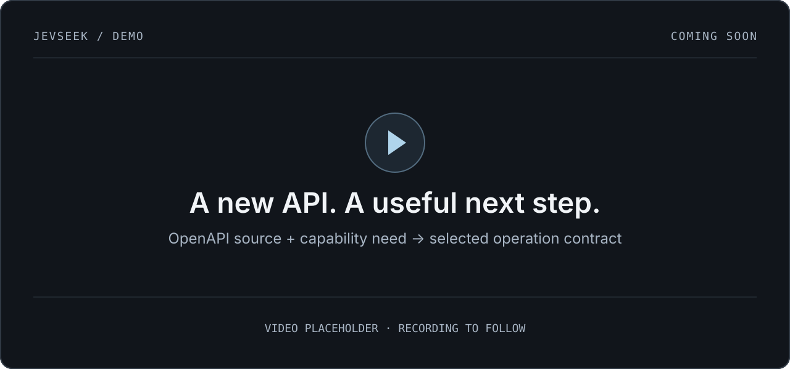

<h1 align="center">JevSeek</h1>

<p align="center">
  <strong>Find the API capability your coding agent needs.</strong><br />
  Search OpenAPI operations and remote MCP tools without loading the full catalog into context.
</p>

<p align="center">
  <a href="https://github.com/dej-h/jevseek/actions/workflows/ci.yml"></a>
  <a href="https://github.com/dej-h/jevseek/releases/latest"></a>
  <a href="https://github.com/dej-h/jevseek/blob/main/package.json"></a>
  <a href="#connect-your-agent"></a>
  <a href="https://github.com/dej-h/jevseek/blob/main/LICENSE"></a>
</p>

<p align="center">
  <a href="#why-install-jevseek">Why install</a> ·
  <a href="#get-started">Get started</a> ·
  <a href="#connect-your-agent">Connect your agent</a> ·
  <a href="#from-a-need-to-a-request">See an example</a>
</p>

JevSeek helps coding agents find their way around unfamiliar APIs and MCP servers. Give it an OpenAPI file, an HTTPS document URL, or a public remote MCP endpoint and describe what you need. It detects the source type, enumerates capabilities, and uses [TypeSafe Jev](https://docs.typesafe.ai) to score their relevance. Discovery returns short ranked targets and a compact source-backed preview for a confident top match. Inspection reads the current source when the preview lacks details for the selected operation or tool.

Use it through the CLI, a TypeScript function, or an MCP discovery tool. No per-API wrapper or embedding index is required for discovery.

## Why install JevSeek?

JevSeek returns a source-backed target and compact contract preview without sending the whole catalog back to the coding agent. In 36 Codex discovery tasks, its serialized MCP response was a few kilobytes even when the OpenAPI source was several megabytes:

| Source, largest first | Catalog source | Median discovery result | Example contract found |
| --- | ---: | ---: | --- |
| GitHub REST API, 1,254 operations | 13.9 MB | 4.4 KB | `GET /repos/{owner}/{repo}/pulls/{pull_number}/files` |
| Stripe API, 626 operations | 4.52 MB | 5.2 KB | `POST /v1/invoices/create_preview` |
| DigitalOcean API, 873 operations | 4.28 MB | 3.6 KB | `POST /v2/load_balancers/{lb_id}/forwarding_rules` |

The size and response figures come from the 36 agent tasks; the example targets come from the [curated discovery cases](docs/discovery-evaluation.md). The response sizes include duplicate text and structured content. A coding agent without JevSeek can search a local file directly, so the table does not count the entire source as tokens saved. In matched tasks, Codex could choose its normal tools in both conditions. The next table reports average uncached Codex input tokens per task:

| Catalog | Tasks | Without JevSeek | With JevSeek | Input change | Median paired time |
| --- | ---: | ---: | ---: | ---: | ---: |
| Oxford Ledge public MCP, 62 tools | 3 needs × 3 runs | 32.4k | 17.3k | 47% less | 1.2 s faster |
| Stripe local OpenAPI | 12 needs | 19.4k | 13.3k | 32% less | 5.7 s slower |
| DigitalOcean local OpenAPI | 12 needs | 18.4k | 15.7k | 15% less | 3.8 s slower |
| GitHub local OpenAPI | 12 needs | 13.0k | 14.7k | 13% more | 0.1 s faster |

Both setups found the checked target and inputs in every task. Across the 36 OpenAPI tasks, enabling JevSeek reduced uncached Codex input by 14% but added 3.7 seconds to the median paired task. Its successful ranking calls processed another 806,194 input tokens at a reported cost of $0.0339; nine discovery calls failed with a connection error and the agent used its other tools to finish. The Oxford comparison used an earlier installed client; its three needs were repeated, while the OpenAPI tasks were distinct. The [full breakdown](docs/agent-product-comparison-detail.md) shows means, medians, and every task alongside the [flat CSV](evals/agent-product-comparison-20261103.csv) and [raw results](evals/agent-product-comparison-20261103.json).

## From a need to a request



You need the files changed by a pull request. Which operation provides them, and what arguments does it require? Fetch the GitHub specification once, then search it:

```bash
./examples/github/fetch.sh
jevseek discover \
  "I need an endpoint that lists the files changed by a pull request" \
  ./examples/github/api.github.com.json --top 1 --short
```

This result came from a local GitHub specification snapshot:

```text
Status: matches
Scanned: 1239 operations
Matches:
  1. [0.96] GET /repos/{owner}/{repo}/pulls/{pull_number}/files (pulls/list-files): List pull requests files
Usage: 1 Jev request, 7532 input tokens, $0.000316344
```

Omit `--short` to return JSON with target names, scores, a compact preview of the top match when confident, scan warning counts, and usage. To read more of the selected operation:

```bash
jevseek inspect ./examples/github/api.github.com.json \
  "GET /repos/{owner}/{repo}/pulls/{pull_number}/files"
```

The snapshot and Jev model can change, so scores, counts, and cost may differ on a later run.

**JevSeek finds the contract. Your agent builds and executes the request using its existing tools.**

## Get started

Requires **Node.js 20+**, npm, and a **TypeSafe API key**. Discovery makes billed calls to TypeSafe.

Install the latest GitHub release:

```bash
npm install -g https://github.com/dej-h/jevseek/releases/latest/download/jevseek.tgz
```

Set your key and discover directly from an HTTPS OpenAPI document:

```bash
export TYPESAFE_API_KEY="your-typesafe-key"

jevseek discover \
  "I need an endpoint that lists the files changed by a pull request" \
  "https://raw.githubusercontent.com/github/rest-api-description/main/descriptions/api.github.com/api.github.com.json" \
  --top 1
```

You can also supply a local JSON/YAML file. Keep API keys out of version control.

For a public remote MCP server, use the same command with its direct HTTPS endpoint. There is no source-type flag:

```bash
jevseek discover \
  "I need to find the institutional holders of a public company" \
  https://www.oxfordledge.com/mcp \
  --top 1
```

That live run scanned 62 tools and selected `get_institutional_holders` with a score of `0.94`. Inspecting that tool returns its current definition and endpoint metadata, including:

```json
{
  "endpoint": "https://www.oxfordledge.com/mcp",
  "transport": "streamable-http",
  "method": "tools/call",
  "tool": "get_institutional_holders"
}
```

JevSeek also discovered `execute` from CoinGecko and `migrate_pages_to_workers_guide` from Cloudflare Docs. Across the three live runs it scanned 66 tools using four Jev requests at a total reported cost of `$0.001599318`. See the [recorded inputs and results](docs/mcp-public-discovery-evidence.md).

Inspection returns the original MCP tool definition. Your execution client establishes its own connection and supplies arguments from that schema. JevSeek does not call the tool, share its discovery session, or grant access. Only public, unauthenticated Streamable HTTP catalogs are supported. OAuth, local stdio sources, resources, and prompts are TODO.

## Connect your agent

JevSeek exposes two MCP tools: **`jevseek_discover`** and **`jevseek_inspect`**. Your coding agent starts the local stdio server automatically and supplies a local OpenAPI path, HTTPS OpenAPI URL, or public remote MCP endpoint with each call. No source registration, source kind, or server restart is needed.

After installing the client, choose your agent:

<details>
<summary><strong>Codex</strong></summary>

Register JevSeek with Codex:

```bash
codex mcp add jevseek \
  --env TYPESAFE_API_KEY="$TYPESAFE_API_KEY" \
  -- jevseek serve
```

Restart Codex, then run `codex mcp list` or check `/mcp` in a CLI session.

The optional [discovery skill](docs/coding-agents.md#optional-discovery-skill) helps Codex recognize capability-search tasks and use JevSeek when an OpenAPI document or public MCP catalog is available. The same skill also works with Claude Code.

</details>

<details>
<summary><strong>Claude Code</strong></summary>

Register JevSeek for your Claude Code user:

```bash
claude mcp add --scope user \
  --env TYPESAFE_API_KEY="$TYPESAFE_API_KEY" \
  --transport stdio jevseek \
  -- jevseek serve
```

Restart Claude Code, then check `/mcp`.

The same optional [discovery skill](docs/coding-agents.md#optional-discovery-skill) can be installed for Claude Code.

</details>

Then give your agent a real public PR URL and ask:

> Use JevSeek with the GitHub OpenAPI file at /absolute/path/github.openapi.json. I need the files changed by this pull request. Find the operation, check its required inputs, and make the public read-only request.

For an MCP catalog, the source is just the endpoint string:

```json
{
  "source": "https://www.oxfordledge.com/mcp",
  "need": "I need to find the institutional holders of a public company",
  "top_k": 1
}
```

See [coding-agent setup and troubleshooting](docs/coding-agents.md) for source restrictions, limits, and common failures.

## When to use it

- **An unfamiliar service:** you have its OpenAPI document, but no custom integration.
- **A large MCP catalog:** the server exists, but injecting every tool definition into the agent wastes context.
- **An integration gap:** your existing tools do not expose the operation you need.
- **Your own API:** discover capabilities from its specification or public MCP endpoint.

If you already know the endpoint, or an installed tool already handles the task, use that directly.

## How it works

```text
source + capability need
  → detect OpenAPI or remote MCP
  → enumerate operations or tools
  → select candidates for large catalogs, then Jev scores descriptors
  → return ranked targets and a compact preview of the top match
  → inspect the current source when more detail is needed
```

Descriptors are compact representations sent to Jev. For large catalogs, Jev ranks a source-derived shortlist first and retries the full catalog when the result is weak. `scan.examinedOperations` and `scan.complete` show how many operations Jev ranked; source enumeration still covers the full catalog. Discovery returns source-derived target names such as `POST /v1/invoices/create_preview` or an exact MCP tool name. A confident top match also includes a bounded preview of its method, path, parameters, and request body, or an MCP tool's input schema. Inspection returns the selected OpenAPI operation with inherited settings and a paged list of reachable local reference names, or the selected MCP tool definition. A large field can be opened using its returned child names. The full catalog is not returned to the coding agent.

The [discovery evaluation](docs/discovery-evaluation.md) records accuracy, ranking cost, and agent workflow results against frozen OpenAPI snapshots.

For OpenAPI, `--parameters`, `--request-body`, and `--responses` enable richer scoring descriptors; they are off by default. MCP descriptors use the tool name, title, description, schemas, and annotations. `--top` controls the number of results. `--short` prints a bounded terminal summary. `jevseek inspect` accepts repeated `--part` fields for large values. Run `jevseek --help` for command options.

<details>
<summary><strong>Use the TypeScript API</strong></summary>

Install the tarball as a project dependency with `npm install ./jevseek.tgz`:

```ts
import { discover } from "jevseek";

const result = await discover(
  "https://www.oxfordledge.com/mcp",
  "I need to find the institutional holders of a public company",
  { topK: 3 },
);
```

</details>

## Support, privacy, and limits

| Area | Current support |
| --- | --- |
| Sources | OpenAPI 3.0/3.1 JSON/YAML from local files or direct HTTPS URLs; public remote MCP tool catalogs over Streamable HTTP |
| References | Reachable local references are available through inspection; external references produce warnings and are not fetched |
| Interfaces | CLI, TypeScript, and stdio MCP |
| Verification | CI and isolated package-install tests on Linux with Node.js 20, 22, and 24; [three live public MCP discovery runs](docs/mcp-public-discovery-evidence.md); live agent execution is not yet verified |

The **need and descriptor content leave your machine and go to TypeSafe**. Use only specifications and catalogs you are authorized to share. By default, the JevSeek MCP server can read files and fetch HTTPS URLs accessible to its process, including internal destinations. For a restricted setup, repeat `--allow-source <file-or-url>` at startup to permit only those exact sources. See [source-access configuration](docs/coding-agents.md#optional-source-restrictions). JevSeek does not execute target operations or grant permission to do so.

Unsupported documents and provider failures produce errors. Unresolved references carry warnings and mark the inspected contract incomplete. Security-scheme definitions and effective parameter overrides still need work; a completeness flag is not proof that a request will succeed. MCP responses have a 256 KiB cap, and inspection opens large values by field. [Detailed limits](docs/coding-agents.md#limits-and-verification).

## Contributing

Found a misleading match or an awkward source catalog? [Open an issue](https://github.com/dej-h/jevseek/issues) with a sanitized source, the capability need, and the expected operation or tool. Do not upload credentials or private schemas.

```bash
git clone https://github.com/dej-h/jevseek.git
cd jevseek
npm ci
npm run typecheck
npm test
npm run release:package
npm run test:package
```

Tests mock TypeSafe responses; package installation fetches dependencies from npm. These checks make no paid Jev calls.

[Design spec](docs/JevSeek_Design_Spec.md) · [Coding-agent guide](docs/coding-agents.md) · [Discovery evidence](docs/mcp-public-discovery-evidence.md) · [Releases](https://github.com/dej-h/jevseek/releases) · [MIT license](LICENSE)
